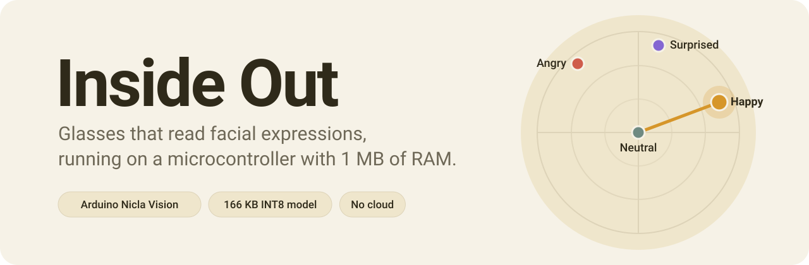
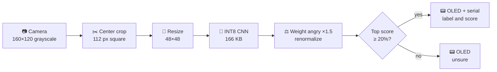
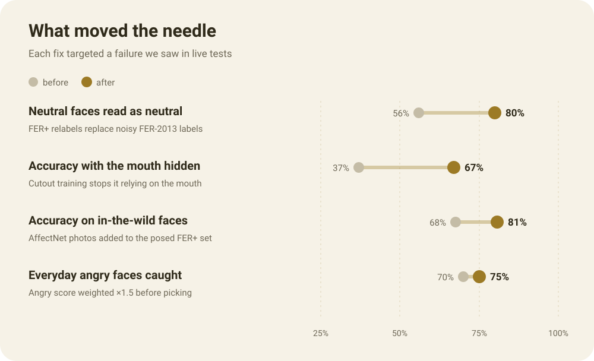
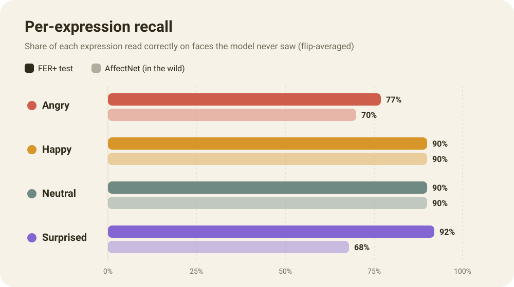
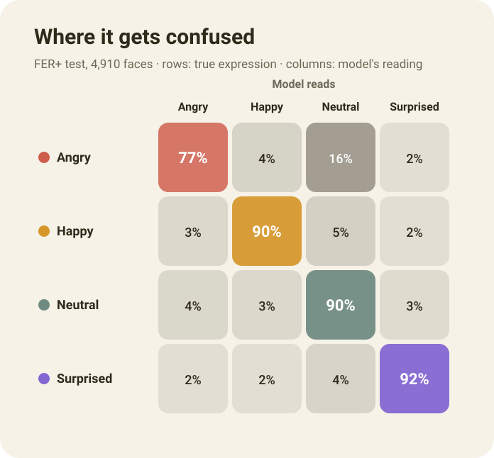
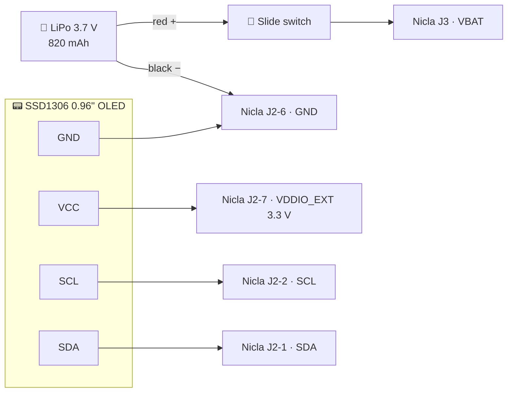

<p align="center">
  
</p>

<p align="center">
  
  
  
  
  
</p>

<p align="center">
  <a href="#-run-it-on-the-glasses">Glasses</a> ·
  <a href="#-try-it-on-a-laptop-camera">Laptop demo</a> ·
  <a href="#-how-it-works">How it works</a> ·
  <a href="#-accuracy">Accuracy</a> ·
  <a href="#-hardware">Hardware</a> ·
  <a href="#-training">Training</a>
</p>

---

Inside Out is a pair of glasses that looks at the person in front of you and shows what their face is expressing on a small OLED by your eye. It's built for people who find facial expressions hard to read, including many autistic people. Everything runs on the glasses: no phone and no cloud, so no images leave the device.

The recommended model reads four expressions:

| | Expression | Looks for |
|:-:|---|---|
| 🔴 | **Angry** | Lowered, pulled-together brows, a hard stare, tight lips. Also covers scrunched, disgusted faces. |
| 🟠 | **Happy** | Lip corners pulled up, cheeks lifted, crinkles at the eyes |
| 🟢 | **Neutral** | Level brows, a relaxed mouth, eyes open normally |
| 🟣 | **Surprised** | Raised, arched brows, wide eyes, an open mouth |

When no expression scores above 20%, it says **unsure** instead of guessing.

## 👓 Run it on the glasses

> [!TIP]
> Everything the glasses need is in [`openmv/`](openmv): the firmware [`main.py`](openmv/main.py), the OLED driver [`ssd1306.py`](openmv/ssd1306.py), and the recommended model folder [`plus_affect_surprise_dis/`](openmv/plus_affect_surprise_dis).

1. **Connect.** Plug the Nicla Vision in with a USB data cable and click **Connect** in OpenMV IDE. Install the latest OpenMV firmware if prompted. See [Arduino's Nicla Vision setup guide](https://docs.arduino.cc/tutorials/nicla-vision/user-manual).
2. **Copy the model.** Copy [`expression.tflite`](openmv/plus_affect_surprise_dis/expression.tflite) and [`labels.txt`](openmv/plus_affect_surprise_dis/labels.txt) to the root of the drive that appears for the board. Keep the two files together. Any other model folder in `openmv/` works the same way.
3. **Run.** Open [`openmv/main.py`](openmv/main.py) and click **Run**. Center one face inside the square in the preview. The expression and its score appear over the preview and in the serial terminal.
4. **Go standalone.** Save the script as `main.py` on the board's drive and copy [`ssd1306.py`](openmv/ssd1306.py) next to it. Then eject the drive and reset the board. With the OLED wired to J2 and the battery connected, the glasses start on power-up and update the display about twice per second. They also run with no OLED attached.

> [!NOTE]
> The square is a fixed crop, so fill most of it with one front-facing face. The model always produces a score, even for an empty frame or an expression it wasn't trained on. It's about 166 KB, roughly six times the compute of the original model. **We haven't measured its frame rate or memory use on the board yet.**

<details>
<summary><b>Firmware settings</b> in <code>openmv/main.py</code></summary>

| Setting | Value | What it does |
|---|---|---|
| `MIN_SCORE` | `0.20` | Below this the glasses show `unsure` |
| `SENSITIVITY` | `{"angry": 1.5, "sad": 2.0}` | Multiplies a class's score before picking the winner. Everyday angry faces are subtler than the training photos. The `sad` entry only applies to models that have a sad class. |

The laptop camera page uses the same threshold and angry weight, so both show the same reading.

</details>

## 💻 Try it on a laptop camera

[`web/camera.html`](web/camera.html) runs any model from `openmv/` on your webcam. It uses a small JavaScript INT8 interpreter whose output matches the official TFLite runtime. Frames never leave the browser.

```powershell
py -m http.server 8000
# then open http://localhost:8000/web/camera.html
```

| Feature | What it adds |
|---|---|
| 🎯 **Face tracking** | Finds the face and lines up the eyes the way the training photos are aligned, so you don't need to hold a fixed square |
| 🧭 **Expression compass** | Shows the reading by pleasantness and energy, with neutral at the center |
| 🔍 **"Why this reading?"** | Lists the facial cues for the expression, flags close calls, and shows an occlusion map of the face regions the model relied on |
| 🔀 **Model switcher** | Switch between any trained model folder live |

## 🧠 How it works



The model is a small grayscale CNN at the dataset's native 48×48 resolution. It has four convolution blocks (16, 32, 64 and 128 filters) and a dense output layer, with INT8 weights and activations so it fits in the Nicla's 1 MB of RAM. Earlier versions misread everyday faces, so each change below fixes a specific failure we saw in live tests:

<p align="center">
  
</p>

- **Noisy labels.** FER-2013's single-annotator labels often call neutral faces sad. Training on the [FER+](https://github.com/microsoft/FERPlus) relabels, where each face was voted on by 10 annotators, fixed most of this.
- **Mouth shortcut.** The model learned "mouth closed means sad, mouth open means angry". Randomly hiding the lower face during training (cutout) made it read the brows and eyes too.
- **Posed photos.** FER faces are often exaggerated. Adding [AffectNet](http://mohammadmahoor.com/affectnet/) photos of everyday faces closed much of the gap.
- **Hard classes.** Sad was dropped for being unreliable live and replaced with surprised. Disgust was folded into angry, so scrunched faces register.

## 📊 Accuracy

<p align="center">
  
</p>

<p align="center">
  
</p>

| Test set | Accuracy | Notes |
|---|:-:|---|
| FER+ test (4,910 faces) | **89.2%** | Held out from training, flip-averaged |
| AffectNet test (in the wild) | **81.3%** | Everyday photos, harder than FER's posed faces |
| AffectNet disgust faces read as angry | **79%** | With the ×1.5 angry weight |

Full numbers are in [`model_metrics.json`](openmv/plus_affect_surprise_dis/model_metrics.json). The most common mistake is reading a subtle angry face as neutral, which is why angry gets the ×1.5 weight.

## 🔧 Hardware



| Part | Notes |
|---|---|
| Arduino Nicla Vision (ABX00051) | Camera faces forward on the right temple |
| 0.96" SSD1306 OLED, 128×64, I²C | Address `0x3C`. Check the pin order on the silkscreen. |
| EEMB LiPo 3.7 V 820 mAh | About **5–6 h** of continuous use |
| 3D-printed mounts | [`nicla_mount.stl`](Hardware/3D%20Prints/nicla_mount.stl) and [`display_battery_holder.stl`](Hardware/3D%20Prints/display_battery_holder.stl). Print in PETG. |

> [!WARNING]
> The Nicla has no reverse-polarity protection, so check battery polarity with a multimeter before soldering. Don't use J3 and J4 at the same time.

Full parts list, wiring and runtime estimate: [`Hardware/BOM.md`](Hardware/BOM.md) · [Cirkit Designer schematic](https://app.cirkitdesigner.com/project/69ebc1e3-7c25-4586-92e4-6b42f8a82b8d)

## 🏋️ Training

The models are trained in TensorFlow and exported as INT8 TFLite for OpenMV. They're separate from the 96×96 MobileNetV2 setup in Edge Impulse Studio.

| Script | Purpose |
|---|---|
| [`train.py`](training/train.py) | Trains and exports a model. Options: `--labels`, `--balance`, `--arch wide`, `--augment`, `--cutout`, `--soft`, `--equalize`. |
| [`build_ferplus.py`](training/build_ferplus.py) | Builds the FER+ dataset from FER-2013 and the FER+ votes. Can fold classes together, for example `disgust=angry`. |
| [`build_affectnet.py`](training/build_affectnet.py) | Combines FER+ with AffectNet faces, cropped to FER framing |
| [`evaluate.py`](training/evaluate.py) | Scores a model on held-out faces, with and without flip averaging |
| [`mouth_test.py`](training/mouth_test.py) | Measures how much a model depends on the mouth |
| [`tune_sensitivity.py`](training/tune_sensitivity.py) | Measures per-class sensitivity trade-offs |

<details>
<summary><b>Reproduce the original model</b></summary>

With Python 3.11, download the [FER-2013 ZIP from Kaggle](https://www.kaggle.com/datasets/msambare/fer2013/data), then run from this folder:

```powershell
py -3.11 -m venv .venv
.\.venv\Scripts\python.exe -m pip install -r training\requirements.txt
.\.venv\Scripts\python.exe training\train.py path\to\fer2013.zip
```

To redraw the README charts after retraining, run `py docs/make_figures.py`.

</details>

<details>
<summary><b>All model folders</b></summary>

| Folder | Classes | Notes |
|---|---|---|
| `plus_affect_surprise_dis` ⭐ | angry, happy, neutral, surprise | **Recommended.** FER+ and AffectNet, cutout, disgust folded into angry |
| `plus_affect_surprise` | angry, happy, neutral, surprise | Same without the disgust merge. Slightly better on pure angry. |
| `plus_affect` | angry, happy, neutral, sad | Same recipe with sad. Sad is hard to read live. |
| `plus_cut`, `plus_wide`, `plus_soft`, `plus_eq` | angry, happy, neutral, sad | FER+ only: cutout, plain, soft labels, histogram-equalized |
| `mvp4`, `mvp3`, `neutral` | various | Original FER labels |
| `mnv2`, `plus_mnv2*` | angry, happy, neutral, sad | MobileNetV2 96×96 experiments, weaker on 48×48 faces |
| `expression.tflite` (root) | angry, happy, sad, surprise | The original small model |

</details>

## 📄 Licenses and data

- The `plus_affect*` models were trained partly on an unofficial copy of AffectNet, which is licensed for non-commercial research only. They're hackathon prototypes, and the images aren't in this repository.
- The OLED driver is from [MicroPython Lib](https://github.com/micropython/micropython-lib/blob/a08087249fda8a7994f7c54ccaad29fb9fcc448a/micropython/drivers/display/ssd1306/ssd1306.py) and is distributed under the [MIT license](openmv/SSD1306-LICENSE.txt).
